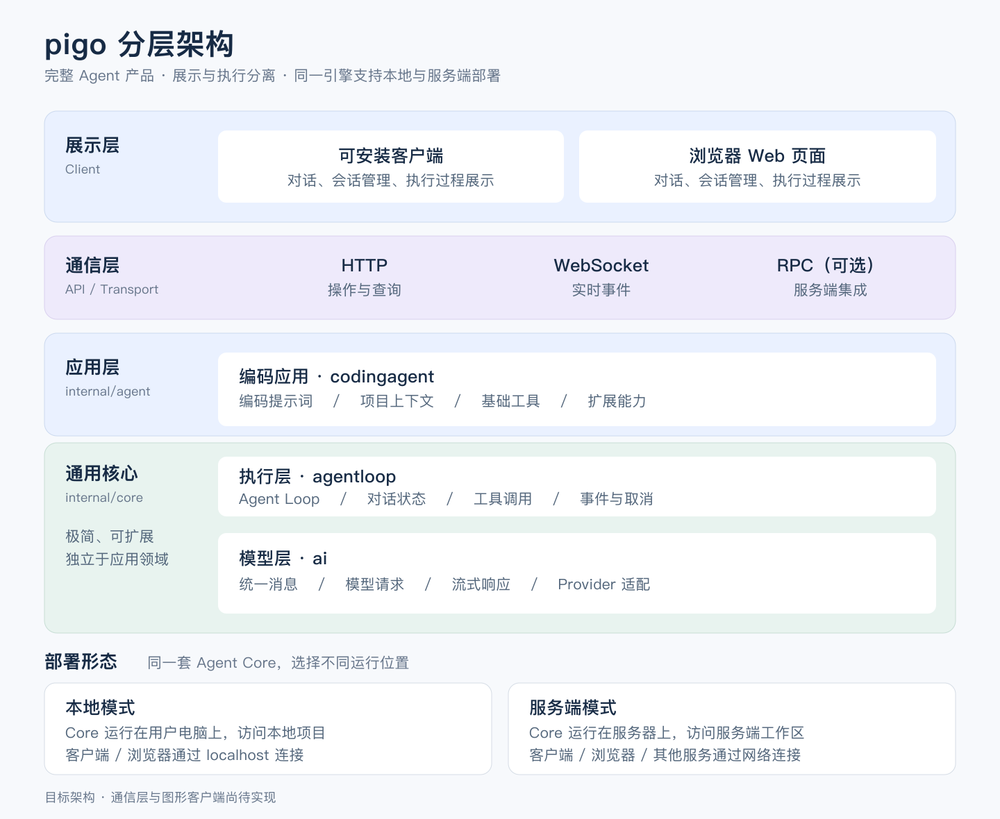

# pigo

pigo 是一个使用 Go 开发的 Agent 产品，参考 pi 的设计，保持核心极简，并通过基础工具和扩展能力支持不同应用场景。首个应用场景是编码助手，后续可通过自定义消息、工具和应用指令扩展到其他领域。

产品采用 Agent Core 与展示层分离的架构。同一套核心引擎既可以运行在用户电脑上，作为本地客户端的后台引擎，也可以部署在服务器上，为远程客户端提供服务。

**项目状态：正在构建中。** API、配置和存储格式尚未稳定，后续可能调整。安装、使用、调试和集成指南将在具备发布条件时补充。

## 设计目标

- 保持核心简单，内置少量基础工具，提供明确的扩展点。
- 分离模型接入、Agent 执行、应用能力和客户端展示。
- 同一套核心引擎支持本地运行和服务端部署。
- 界面和通信协议独立于 Agent 执行循环。
- 遵循 Go 的语言习惯，优先使用标准库，避免不必要的抽象。

## 分层架构



[查看 SVG 矢量图](docs/images/pigo-layered-architecture.svg)。图中展示的是目标产品架构，通信层和图形客户端尚待实现。下表说明当前代码中的模块职责。

| 模块 | 职责 |
| --- | --- |
| `internal/core/ai` | 定义与模型服务商无关的消息、内容、请求、工具声明和用量统计 |
| `internal/core/ai/deepseek` | 适配 DeepSeek 的流式接口 |
| `internal/core/agentloop` | 模型与工具执行循环、对话状态、事件、取消和输入队列 |
| `internal/agent/codingagent` | 编码提示词、项目上下文、基础工具和会话持久化 |
| `internal/agent/codingagent/tools` | 编码场景的基础工具 |
| `internal/storage` | 有大小限制的文本读取与原子文件写入 |
| `cmd/pigo` | 初步的终端客户端 |

`codingagent` 位于应用层，组合 `core/agentloop` 的能力；`agentloop` 使用 `core/ai` 定义的模型调用契约。`internal/agent/` 仅组织具体应用，不定义重复的通用 Agent 接口。客户端负责交互与展示，通过通信层控制应用并接收事件。未来的可安装客户端和 Web 页面将复用同一套核心引擎。

## 代码结构

```text
pigo/
├── cmd/pigo/                       # 当前终端入口
├── internal/
│   ├── core/
│   │   ├── ai/                     # 统一消息与模型接入
│   │   └── agentloop/              # 通用 Agent 执行能力
│   ├── agent/
│   │   └── codingagent/            # 编码应用
│   │       ├── prompt.go           # 默认系统提示词
│   │       ├── context.go          # 项目上下文
│   │       ├── session.go          # 编码会话的组装与保存恢复
│   │       └── tools/              # 基础编码工具
│   └── storage/                    # 共享文件读写能力
└── docs/images/                    # 架构图
```

后续按功能开发进度增加 `internal/app`、`extensions`、`transport`、`config` 和 `observability`，分别承载产品运行管理、扩展、通信、配置与监控。展示层放在 `clients/web`，桌面封装放在 `clients/desktop`；协议定义、扩展示例、跨模块集成测试和构建脚本分别放在 `api`、`examples`、`tests/integration` 和 `scripts`。这些目录尚未实现，当前不创建空骨架。

Go 实现位于 `internal`，不作为可被外部 Go 模块直接导入的公共库。开发者扩展的接入协议将在扩展机制开发时确定。单元测试与实现放在同一目录。

## 当前能力

- 可扩展的消息与内容接口，以及内置消息类型的复制、序列化和反序列化。
- DeepSeek 流式文本、推理内容、工具调用和用量统计。
- 模型与工具执行循环，支持有序事件、取消、轮次限制、转向消息和后续消息队列。
- 有状态对话，支持快照、重置和达到轮次上限后的继续执行。
- 编码指令，以及当前工作目录和上级目录中的 `AGENTS.md` 加载。
- `read`、`write`、`edit`、`bash` 四个基础工具。
- 显式保存与加载会话，以及最小可用的终端客户端。
- 使用模拟模型、本地 HTTP 服务和临时文件的自动化测试。

当前 DeepSeek 适配器支持文本输入，暂不支持图片输入。会话持久化支持内置消息类型，恢复时要求工作目录一致。工具使用宿主进程的权限执行，尚未内置沙箱或托管环境下的会话隔离。

## 开发路线

以下为计划开发的能力，排列顺序体现当前优先级，不代表发布承诺。客户端技术选型和通信细节仍待确定。

### 1. 核心可靠性与上下文管理

- [ ] 完善流式响应、取消、工具结果处理和中断后的恢复行为，并补充回归测试。
- [ ] 增加上下文用量跟踪和可配置的对话压缩，保留工具调用与结果的配对关系，以及模型服务商要求回传的上下文数据。
- [ ] 定义模型服务商的能力描述，接入更多模型，并将服务商差异封装在适配层。

### 2. 编码工作流与扩展能力

- [ ] 在显式保存与加载的基础上，增加会话列表、切换和分支能力。
- [ ] 增加可复用的提示词模板和技能（Skills），支持不同编码工作流。
- [ ] 定义精简的应用扩展接口，支持自定义工具、指令和生命周期钩子，将应用策略保留在通用执行循环之外。
- [ ] 完善项目上下文加载，以及大文件和工具输出的处理。

### 3. 客户端与服务模式

- [ ] 改善终端交互，清晰展示工具执行进度，并完善对话控制。
- [ ] 增加 HTTP 接口，支持会话创建、消息提交、取消执行和状态查询。
- [ ] 增加 WebSocket 事件流，定义事件序列化和客户端断线重连行为。
- [ ] 按需增加 RPC 接口，为其他服务提供相同的核心能力。
- [ ] 基于服务接口开发 Web 展示层，后续提供可安装客户端。
- [ ] 为服务端部署增加身份认证、会话工作区隔离、资源限制和可配置的工具权限。

### 4. 发布准备

- [ ] 稳定公共接口、配置和会话存储格式。
- [ ] 建立持续集成检查，覆盖支持的 Go 版本与操作系统。
- [ ] 准备版本发布、可执行文件和更新日志。
- [ ] 补充安装、使用、调试、集成和部署指南。

## 开发说明

需要 Go 1.22 或更高版本，当前没有第三方 Go 依赖。开发约定见 [AGENTS.md](AGENTS.md)。
